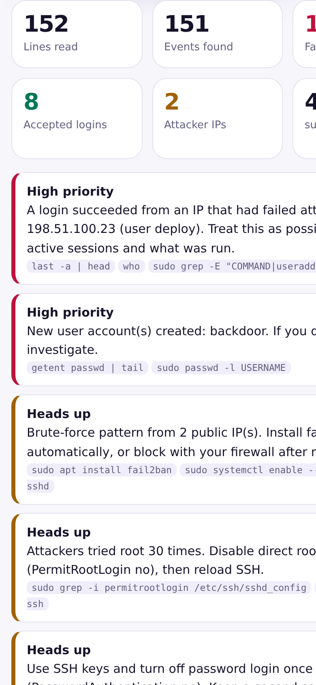

# Linux Log Analyzer

Paste or drop auth.log, secure or journalctl output. Find failed SSH logins, top attacker IPs, usernames tried, sudo activity, account changes and an hourly timeline. Free, private, in-browser.

## Screenshots




## Features

- Parses Debian/Ubuntu auth.log, RHEL/CentOS secure, journalctl and rsyslog ISO timestamps
- Failed and invalid-user SSH attempts, accepted logins, pre-auth drops
- Top IPs with a simple brute-force rule, usernames tried
- Flags a login that succeeded after failures from the same IP
- sudo commands, new users and password changes, services with errors, out-of-memory kills
- Hourly timeline chart, filterable event table, CSV export
- Copy IP list and review-first block commands
- Made-up sample log included

## How to use

1. Paste log lines or drop a log file (up to about 25 MB).
2. Tap Analyze.
3. Read the high-priority alerts first, then confirm on the server.

## Honest limits

- Lite analyzer for common OpenSSH, sudo and PAM message formats.
- Logs without a year assume the year field (default current year).
- Likely brute force is a simple rule and can be a false alarm. Verify before blocking.
- Block commands are text only.

## Tech and privacy

Plain HTML, CSS and JavaScript. No build step, no tracking, no backend. Everything runs in your browser. Nothing you type is uploaded. Installable as a PWA and works offline after the first visit.

## Run locally

```bash
git clone <this repo>
cd <folder>
python3 -m http.server 8000
# open http://localhost:8000
```

## Deploy free

GitHub Pages: Settings, Pages, Deploy from branch `main`, folder `/ (root)`.

## Author

Built by Akash Vishwakarma.
